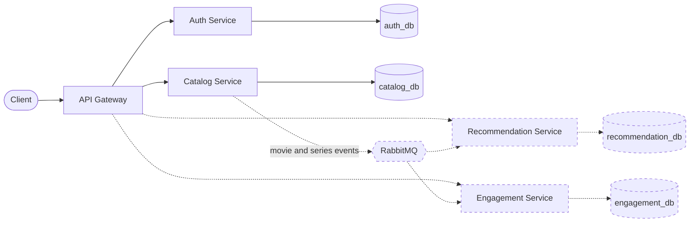

# CineScope

A movie and TV platform built as a set of microservices. It exists to exercise Domain-Driven Design, Clean Architecture and event-driven patterns end to end, from an API gateway down to a Kubernetes deployment on minikube.



Solid lines are implemented and dashed lines are planned. Every request enters through the gateway, which verifies the caller's JWT, applies a static access policy and forwards the token unchanged. Services verify it again on their own ([ADR 0001](docs/adr/0001-jwt-propagation.md)).

## Services

| Service        | Status                                            | Responsibility                                                                            |
| -------------- | ------------------------------------------------- | ----------------------------------------------------------------------------------------- |
| API Gateway    | In progress: proxy, authentication, authorization | Single entry point: routing, JWT verification, access policy                              |
| Auth           | Implemented                                       | Signup, login, rotating refresh tokens, roles and permissions                             |
| Catalog        | Implemented                                       | Movies with full CRUD (series in progress); people, genres and companies with create/read | create/read |
| Recommendation | Planned (Phase 3)                                 | Builds recommendations from the events Catalog publishes                                  |
| Engagement     | Planned (Phase 4)                                 | Reviews and watchlists, with ownership-based authorization                                |

Until `chore/engagement-merge` lands, Engagement still exists as the `review-service` and `watchlist-service` placeholders, which expose only `/health`.

## Tech stack

### Implemented

- **Runtime:** Node.js 24, TypeScript, Express, Zod, http-proxy-middleware
- **Data:** PostgreSQL 16 with Prisma
- **Security:** HS256 JWT access tokens, rotating refresh tokens, permission-based RBAC enforced at the gateway and in each service
- **Testing:** Jest and Supertest, plus integration suites against a real Postgres
- **Tooling:** npm workspaces, Docker, Docker Compose, ESLint, Prettier, GitHub Actions

### Planned

- **Messaging:** RabbitMQ, with outbox, inbox, retries and dead-letter queues (Phase 3)
- **Cache:** Redis, already provisioned in Compose but not yet used by any service
- **Deployment:** Kubernetes on minikube (Phase 5)
- **Security:** RS256 with JWKS, then OAuth 2.0 Authorization Code and OpenID Connect (Phase 6)

## Design principles

- One bounded context per service, with Clean (hexagonal) Architecture inside each one
- Database per service
- Defense in depth: coarse-grained authorization at the gateway, fine-grained checks in the services
- Integration through domain events and eventual consistency (planned)

## Documentation

- [Roadmap](docs/roadmap.md): phases and the branch behind every step
- [Architecture Decision Records](docs/adr/)
- [OpenAPI spec](docs/api/cinescope.openapi.json): every route reachable through the gateway
- [Development guide](docs/development.md): workspace setup, testing, CI and production images

## Repository layout

```
apps/        one folder per service
packages/
  shared/    @cinescope/shared: domain, application and HTTP building blocks
infra/       Postgres initialisation
docs/        roadmap, ADRs, OpenAPI spec, development guide
```

Business services share the same layering: `domain/`, `application/`, `infrastructure/` and a `main/` composition root.

## Getting started

Only Docker is required; Node.js does not need to be installed on the host.

```bash
docker compose up
```

The first run installs the workspace, builds the shared package, applies migrations and seeds auth-service. The gateway listens on `http://localhost:4000`.

```bash
docker compose run --rm --no-deps deps npm test                    # unit and HTTP tests
docker compose run --rm deps npm run test:int -w catalog-service   # integration tests (starts Postgres)
docker compose run --rm deps npm run lint
```

## License

Released under the MIT License.
